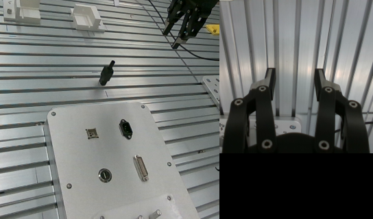

# 首次启动偏离排查（2026-10-14）

这份记录确认首次推理在夹爪尚未全开时开始，模型返回的首段动作已偏离实测关节位置；记录缺少 H 后恢复的预测，因此尚不能完成两次预测的因果对比。

来源：`results/flexiv_bootstrap_diagnosis/session_de283d7a-990b-4d3b-9be1-e9217d81afed`，checkpoint 为 `chkpt_1014_16000/full_weights.pt`。写入统计为 4 条、丢弃 0 条、错误 0 条。唯一 infer 为 frame 0；另有 frame 577 的 reset_context 和 frame 1378 的 finish。

| 项目 | 首次记录 | 参考 |
| --- | --- | --- |
| 输入夹爪宽度 | 0.04089 m | 配置打开宽度 0.06 m；Home 数据首帧 0.05994 m |
| 首个模型夹爪目标 | 0.023725 m | 比输入再闭合约 17.17 mm |
| 第 22 个夹爪目标 | 0.017083 m | 比输入再闭合约 23.81 mm |
| J2 首目标相对输入 | +1.62253° | 原始预测已包含此变化 |
| J7 首目标相对输入 | +1.02403° | 原始预测已包含此变化 |
| 首次 RTC committed | None | 未使用历史动作前缀 |
| 客户端所选动作 | 原始输出第 0 至 21 帧 | 与 full_actions_physical 完全相同 |

输入 J1、J3 相对所用 Home 数据首帧分别约偏 -0.275°、+0.274°，仍在当前 0.5° Home 容差内。J3 实测为 0.113804 rad，高于 state q99 的 0.109060 rad；这属于训练统计的分位区间，不代表 SDK 关节越界。尚无恢复样本能证明该差异是否在 H 后消失。

## 已修正的问题

myq 初始化辅助函数只等待 is_moving 停止，局部启动流程没有再次确认实际宽度已经达到打开目标。现已在默认初始化并打开的路径中等待实际宽度达到配置目标 ±1 mm 且停止运动；超过初始化 timeout 时中止启动，不发送首段模型动作。跳过初始化或关闭 open_on_start 的配置保持原有语义。

恢复模型控制会发送 reset_context，随后使用普通 infer，而非 bootstrap。之前的启动诊断过滤因此漏掉 H/Space 恢复预测。现已保存 reset_context 后的首个实际推理，并继续排除普通续推理、warmup、预览与逐周期回执。

## 验证边界

以上修正消除了已观察到的启动前置状态问题和诊断漏记，不证明全部偏离均由夹爪引起。需要重新采集首次启动与 H 后恢复两次预测，确认首帧全开并比较图像、关节 state 和相同噪声下的输出。没有执行真机控制或离线加载当前模型重放。

